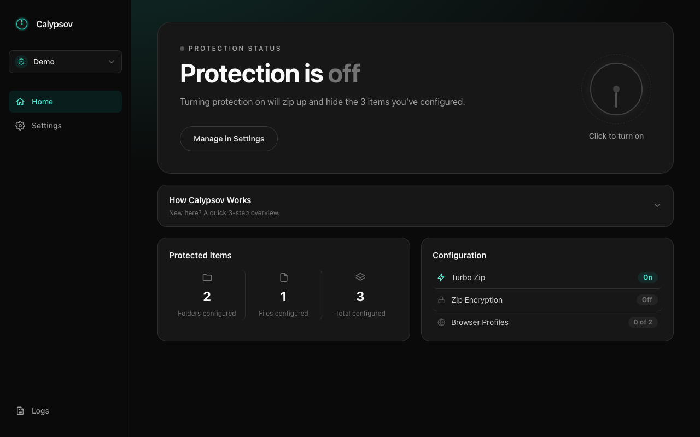
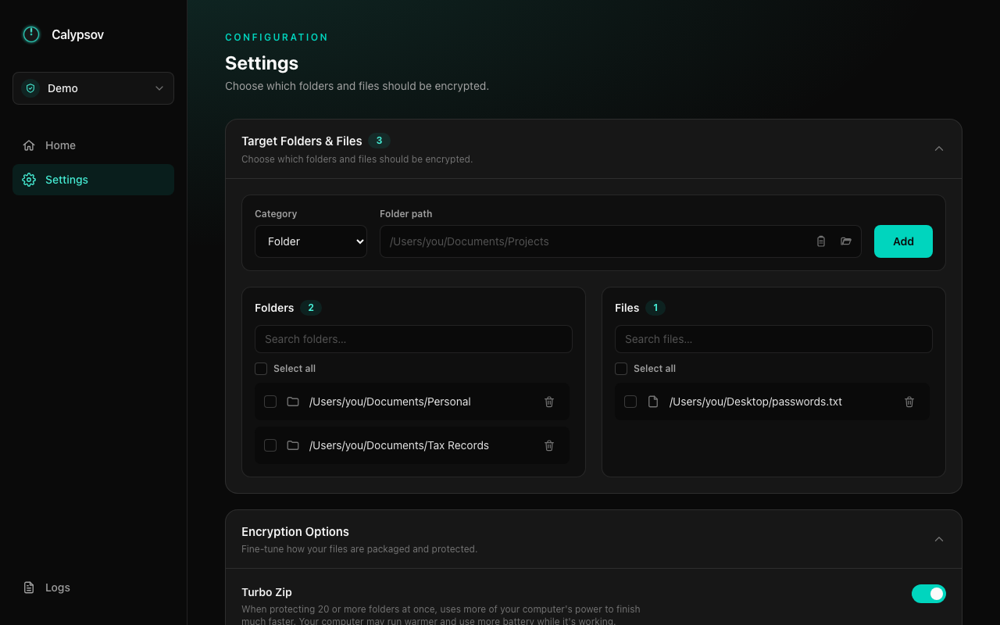

<div align="center">
  

  <h1>Calypsov</h1>

  <p><b>A simple, local-first file &amp; folder protection app for macOS and Windows.</b></p>
  <p>Hide your private folders, files, and browser profile data behind one toggle — no cloud, no account, nothing ever leaves your machine.</p>

  <p>
    <a href="https://github.com/NASAboy342/Calypsov/releases/latest"></a>
    
    <a href="LICENSE"></a>
  </p>
</div>



## What is Calypsov?

Calypsov is a small desktop utility that zips up and hides the folders, files, and browser profile data you choose — with one click — so they disappear from plain sight until you turn protection back off. Think of it as a personal "privacy switch" for your computer: useful for shared machines, quick handoffs, or just keeping certain folders out of sight when you're not actively using them.

Everything happens locally. There's no server, no account, and no cloud sync — your files are zipped on your own disk, and nothing is ever uploaded anywhere.

## Features

- **One-click protection toggle** — turn protection on or off from a single dial on the Home screen. Configured folders/files are zipped and the originals removed; turning it back off restores everything exactly as it was.
- **Protection Profiles** — keep separate configurations for different contexts (e.g. "Personal" and "Work") and switch between them instantly from the sidebar or the Profile Settings page. Each profile has its own folders, files, and browser-profile selections.
- **Folders, files, and browser profiles** — protect whole folders, individual files, and even a selected Edge/Chrome profile's data (bookmarks, saved logins, etc.) in one sweep.
- **Turbo Zip** — splits large batches of folders across multiple CPU cores for noticeably faster protection once you've configured 20+ folders.
- **Optional zip &amp; settings encryption** — add an extra layer of protection to the zipped archive itself, and keep your configured list of protected paths hidden from anyone else using your computer.
- **Activity log** — see exactly what the app has done, with a searchable log viewer for troubleshooting.
- **Built-in update checks** — Settings → About &amp; Updates tells you when a newer version is available, with a one-click link to it.



## Download

Grab the latest build for your OS from the [**Releases**](https://github.com/NASAboy342/Calypsov/releases/latest) page:

| OS | File |
|---|---|
| macOS (Apple Silicon) | `Calypsov-X.Y.Z-osx-arm64.dmg` |
| Windows (64-bit) | `Calypsov-X.Y.Z-win-x64-setup.exe` |

> **Note:** builds aren't code-signed yet (no Apple Developer Program / Windows code-signing certificate). macOS will show an "unidentified developer" warning on first launch — right-click the app and choose **Open** to bypass it. Windows will show a SmartScreen warning — click **More info → Run anyway**.

## Tech stack

Calypsov is a [Photino.NET](https://www.tryphotino.io/) desktop app: a lightweight native window around a web UI, backed by a real ASP.NET Core minimal API — no Electron, no bundled Chromium.

- **Backend:** .NET 8, ASP.NET Core Minimal APIs, Photino.NET / Photino.NET.Server
- **Frontend:** Vue 3 (Composition API) + TypeScript, Vite, Pinia, Tailwind CSS v4
- **CI/CD:** GitHub Actions builds and publishes both platforms automatically from a pushed version tag

## Development

### Prerequisites
- [.NET 8 SDK](https://dotnet.microsoft.com/download)
- [Node.js](https://nodejs.org/) 20+

### Running locally

```bash
# Frontend (terminal 1)
cd Calypsov/UserInterface
npm install
npm run dev

# Backend (terminal 2)
cd Calypsov
dotnet run
```

In debug builds, the app's native window loads the Vite dev server directly, so frontend changes hot-reload while you work.

### Project structure

```
Calypsov/
├── Api/              # Minimal API endpoint groups
├── Services/         # Business logic (interface + implementation per feature)
├── Models/           # DTOs and persisted records
├── Repositories/     # Settings-file persistence
├── Helpers/          # Zip helpers
└── UserInterface/    # Vue 3 frontend (src/views, components, stores, services)
scripts/              # Packaging scripts (macOS .dmg, Windows installer)
.github/workflows/    # CI release pipeline
```

For detailed architecture notes and conventions, see `Calypsov/PROJECT_README.md` (backend) and `Calypsov/UserInterface/PROJECT_README.md` (frontend).

## Releasing

Releases are fully automated: bump `<Version>` in `Calypsov.csproj`, commit, tag `vX.Y.Z`, and push — GitHub Actions builds the macOS `.dmg` and Windows installer in parallel and publishes the GitHub Release.

## License

[MIT](LICENSE) — free to use, modify, and redistribute, including commercially.
